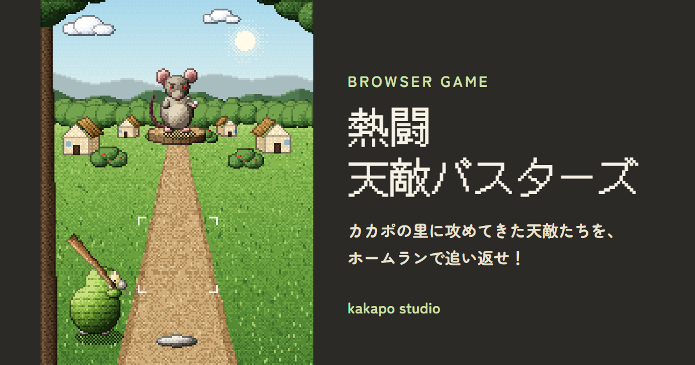

# 熱闘天敵バスターズ

カカポの里に攻めてきた天敵たちを、ホームランで追い返すバッティングゲームです。
スーファミ風のドット絵で、HTML・CSS・JavaScript（canvas）だけで作っています。PC でもスマホでも遊べます。

### ▶ [ゲームを遊ぶ](https://kakapo-studio.com/games/tenteki-busters/)



## 遊び方

| 操作 | PC | スマホ |
|---|---|---|
| バットを振る | 画面のどこかをクリック／`Space` | 画面をタップ |

- 合わせるのは**タイミングだけ**。球がとどく瞬間にピッタリ振るほど、遠くへ飛びます
- 1ステージ10球。決められた本数のホームランを打てたらクリア
- 球が飛んできている間は何回でも振れます（振ったあと、バットが構えにもどるまでは振れません）

### 攻めてくる天敵たち

天敵は、実際にカカポを絶滅の危機に追いこんだ動物たちがモチーフです。ステージが進むほど強くなり、空も昼 → 夕方 → 夜に変わっていきます。

| ステージ | 天敵 | 投げてくる球 | クリア条件 |
|:---:|---|---|:---:|
| 1 | ネズミのチュータ | ストレート | 3本 |
| 2 | ノラネコのクロベエ | 速球・スローボール | 4本 |
| 3 | フェレットのクネリ | 曲がる・落ちる・浮き上がる | 4本 |
| 4 | オコジョのシロガネ | 消える・止まる | 5本 |
| 5 | 大ワシのハースト大王 | ジグザグ・分身・瞬間移動・急加速 | 5本 |

## 特徴・工夫した点

- **ドット絵をプログラムで描く**
  160×214 ドットの小さな canvas に描いて、ぼかさずに3倍にして表示しています。ドットを1つずつ手で打つのではなく、「決まった色の段階（パレット）だけを使う」「段階の境目は 4×4 の表（ベイヤー行列）で点を混ぜる」「輪郭は黒ではなく、その色を暗くした色にする」といったドット絵の描き方のルールを `pixel.js` にまとめています。
- **奥行きの表現**
  球の進み具合 t（0＝ピッチャー、1＝バッター）に対して位置を `t × t` で動かすと、遠くではゆっくり、近づくほど速く見えます。
- **変化球の作り方**
  `sin(π × t) × t` は、とちゅうでふくらんで最後に 0 にもどります。これを横に足すとカーブ、上に足すとフォーク。最後はかならず同じ場所にとどくので、当たり判定は「とどく場所」だけを見れば済みます。
- **魔球は「時間」と「見た目」をいじるだけ**
  止まる球は時間を一時停止、急加速は `t の 2.4乗`、消える球はとちゅうで描かないだけ、分身はニセモノを左右に描いて最後に消しています。
- **タイミングだけで飛距離が決まる**
  振った瞬間の「時間のずれ」だけで、当たったか、どれだけ飛ぶか、左右どちらに飛ぶかを決めています。
- **効果音はプログラムで生成**
  音声ファイルを使わず、Web Audio API で音を作っています。
- **むずかしさは数字で調整**
  ステージごとの必要本数・球の速さ・球種の出やすさは `stages.js` にまとめてあり、数字を変えるだけで調整できます。

## 使用技術

- HTML / CSS / JavaScript（ライブラリ・フレームワーク不使用）
- canvas（ドット絵の描画）
- Web Audio API（効果音）
- localStorage（記録・音のオン／オフの保存）

## ファイル構成

```
tenteki-busters/
├── index.html    画面の構造
├── style.css     見た目
├── script.js     ゲームの動き（投球・当たり判定・画面の切り替え）
├── stages.js     ステージ（天敵）のデータ
├── pixel.js      ドット絵の描き方のルールと、背景・キャラクターの描画
├── sound.js      効果音
├── favicon.svg   タブに表示されるアイコン
└── images/       OGP 画像
```
